<a href="https://nathan.bonnell.fr">
  
</a>

  
  
  
  

 


 

<!-- fivem:start -->
<a href="https://github.com/Wiibleyde?tab=repositories&q=fivem"></a>

  <a href="https://mindcity-rp.fr"><b>🎮 MindCity RP</b></a> ·
  <b>Régie</b> 🔒 private ·
  <b>Race Leaderboard</b> 🔒 private ·
  <a href="https://github.com/Wiibleyde/Fivem-Cam-Script"><b>Cam Script</b></a> ·
  <a href="https://github.com/Wiibleyde/Fivem-Regie-Camera-Script"><b>Régie Cameras</b></a> ·
  <a href="https://github.com/Wiibleyde/Fivem-Npc-Script"><b>NPC Script</b></a> ·
  <b>RP Server</b> 🔒 private

<!-- fivem:end -->

 

<table align="center">
  <tr>
    <td align="center" width="170"><b>🧬 Languages</b></td>
    <td></td>
  </tr>
  <tr>
    <td align="center"><b>🎮 FiveM</b></td>
    <td></td>
  </tr>
  <tr>
    <td align="center"><b>🎨 Frontend</b></td>
    <td></td>
  </tr>
  <tr>
    <td align="center"><b>⚙️ Backend & Data</b></td>
    <td></td>
  </tr>
  <tr>
    <td align="center"><b>🚀 DevOps & Tools</b></td>
    <td></td>
  </tr>
  <tr>
    <td align="center"><b>🤖 AI & Agents</b></td>
    <td></td>
  </tr>
</table>

  
  
  
  
  
    
  
  
  
  

 

<!-- featured:start -->

  <a href="https://marketplace.visualstudio.com/items?itemName=NathanBonnell.stream-guard"></a>
  <a href="https://wiibleyde.github.io/LiveCraft/"></a>
  <a href="https://github.com/Wiibleyde/Eve"></a>
  <a href="https://wikiguessr.bonnell.fr"></a>
  <a href="https://nathan.bonnell.fr"></a>
  <a href="https://github.com/Wiibleyde/TheSmallestLittleThing"></a>

<!-- featured:end -->

 


 

<!-- recent:start -->

<!-- recent:end -->

 

<picture>
  <source media="(prefers-color-scheme: dark)" srcset="https://raw.githubusercontent.com/Wiibleyde/Wiibleyde/output/snake-dark.svg" />
  <source media="(prefers-color-scheme: light)" srcset="https://raw.githubusercontent.com/Wiibleyde/Wiibleyde/output/snake.svg" />
  
</picture>

 
 

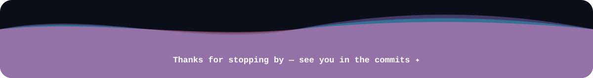
